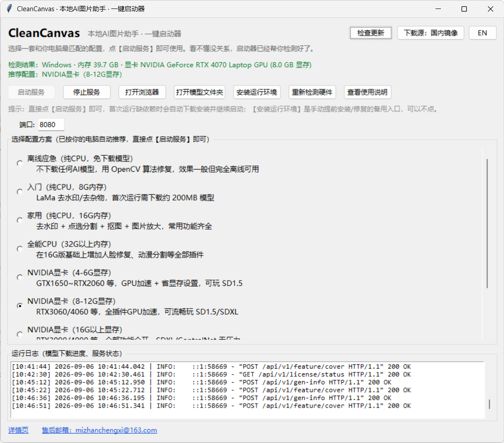
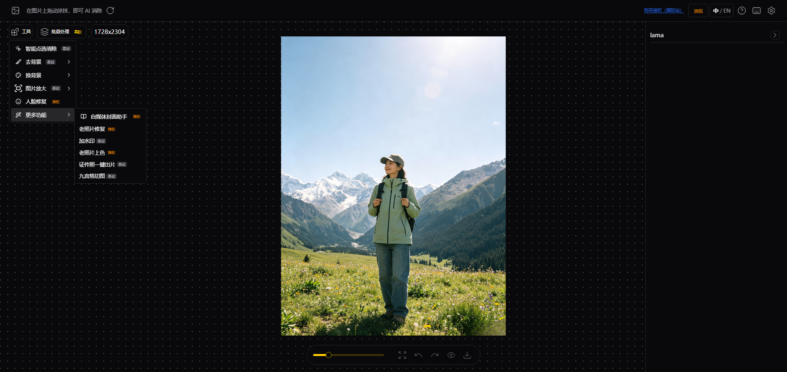

# Klaruvo

**English** · [简体中文](README.zh-CN.md)

**A local AI image toolkit — batch processing · social-media cover maker · move text & objects · watermark removal · background removal · outpainting · upscaling**

Your images never leave your machine. Offline-capable, no ads, no watermarks.

[Download](#-download--install) · [Features](#-features) · [FAQ](#-faq) · [Product details (International)](https://www.powersoftware.app/product/detail/klaruvo) · [China site](https://www.powersoftware.cn/product/detail/klaruvo)

---

## ✨ Features

> **Three headline capabilities: batch processing · social-media cover maker · move text & objects**

| Capability | Description |
| --- | --- |
| 📦 **Batch processing** | Pick a folder of images, apply one set of settings to all of them, and download the results as a zip |
| 🖼 **Social-media cover maker** | Enter a title / subtitle once and generate covers for 18 platform presets (Xiaohongshu/RED, Douyin, Bilibili, WeChat Official Accounts, YouTube, Instagram, Facebook, LinkedIn…), packaged together as a zip |
| ↔️ **Move text & objects** | Drag text, stickers or objects to a new position — the original area is inpainted automatically. "Text mode" only moves strokes matching the pen colour, leaving the background untouched |
| 🧹 **Watermark / object removal** | Brush over it and the AI reconstructs the background |
| 🖌 **Smart click-to-erase** | Click to select a target, then erase it — no precise brushing needed |
| ✂️ **One-click background removal** | Separates subject from background automatically; outputs transparent or a chosen fill colour |
| 🔍 **Upscaling** | Super-resolution upscaling for sharper detail |
| 😊 **Face restoration** | Restores old or blurry faces; can also colorise black-and-white photos |
| 🪪 **ID photos** | One-click crop to standard ID-photo sizes and swap the background colour |
| 🔄 **Background replacement** | Three modes — ID photo / product shot / portrait — with a solid colour or a custom background image |
| 🖼 **AI outpainting / repaint** | Extend the canvas, or repaint a region from a prompt |
| 🌐 **Bilingual UI** | Switch between 中 / EN in the top-right corner |
| 🔒 **Runs locally** | Images are never uploaded; fully offline once the models are downloaded |

**What batch processing can do** (process an entire folder at once):

`watermark removal` · `upscaling` · `background removal & fill colour` · `face restoration` · `photo colorisation` · `background replacement` · `ID photos` · `social-media covers`

**Key improvements for non-technical users:**

- **One-click launcher** — a GUI that detects/installs the runtime, downloads models, starts the service and opens your browser. No command line needed.
- **Robust download system** — multi-mirror speed testing and selection (official / self-hosted / community mirrors), parallel chunked downloads, resume support and automatic fallback from slow mirrors. Downloads stay reliable on networks in mainland China too.
- **Hardware presets** — from low-end CPU-only machines to high-end discrete GPUs; the launcher recommends the right preset for your machine.
- **Batch processing** — batch watermark removal / background removal / upscaling / background replacement over a whole folder, with one-click zip packaging.

## 📸 Screenshots

| One-click launcher | Main UI |
| --- | --- |
|  |  |

## 🚀 Download & Install

Grab the build for your platform from the **[Powersoftware.app] [powersoftware.app/product/detail/klaruvo](https://www.powersoftware.app/product/detail/klaruvo)** page:

| Platform | File | How to use |
| --- | --- | --- |
| Windows | `Klaruvo-Setup.exe` | Double-click to install → launch from the desktop shortcut; the runtime is downloaded automatically on first use |
| macOS | `Klaruvo-mac-<arch>.dmg` | Open the DMG and drag the app into Applications; on first launch, right-click → Open (bypasses Gatekeeper) |

> The installer itself is small: the runtime and AI models are **downloaded automatically on first launch**, after which the app works fully offline.
> The launcher detects an existing runtime on your machine, so nothing is downloaded twice.

**Requirements**: Windows 10/11 or macOS; ~15 GB of free disk space for model caching;
an NVIDIA GPU is optional for acceleration (CPU works too).

## ❓ FAQ

| Problem | Solution |
| --- | --- |
| Port already in use | Change the port in the launcher and restart |
| Model download failed | The launcher retries across mirrors automatically; you can also download the files manually and place them in the models directory |
| Out of VRAM | Switch to a lower hardware preset in the launcher |
| `fbgemm.dll` error on Windows | Known PyTorch issue; switching the PyTorch version resolves it |
| macOS says the app is damaged / won't open | Right-click → Open, or allow it under System Settings → Privacy & Security |

## 🛒 Trial & Licensing

Klaruvo is launched on **[PowerSoftware (幂栈网)](https://www.powersoftware.app)** — a software distribution and license-management platform for indie developers.

👉 **Product details / Free trial / Buy a license**

- 🌐 **International site (English)** — [powersoftware.app/product/detail/klaruvo](https://www.powersoftware.app/product/detail/klaruvo)
- 🇨🇳 **China site (中文 / domestic)** — [powersoftware.cn/product/detail/klaruvo](https://www.powersoftware.cn/product/detail/klaruvo)

- **Try before you buy** — download the full installer for free, then purchase a license key to unlock the paid features
- **Automatic delivery** — the license key is issued automatically after payment and emailed to you; activate it in-app with one click
- **Global payments** — Alipay / WeChat Pay / PayPal / Waffo (credit card, Apple Pay, Google Pay)

## 📄 License & Credits

This software is built on top of the open-source project [IOPaint](https://github.com/Sanster/IOPaint).
The distributed binaries are licensed under [Apache-2.0](LICENSE). This repository only provides
the product page and download entry points and **does not contain the source code**.
See the supplementary notice at the end of [LICENSE](LICENSE).

Core capabilities come from these excellent open-source projects:

[IOPaint](https://github.com/Sanster/IOPaint) · [LaMa](https://github.com/advimman/lama) · [SAM](https://github.com/facebookresearch/segment-anything) · [Real-ESRGAN](https://github.com/xinntao/Real-ESRGAN) · [GFPGAN](https://github.com/TencentARC/GFPGAN) · [AnyText](https://github.com/tyxsspa/AnyText) · [PowerPaint](https://github.com/zhuang2002/PowerPaint)

---

This repository does not accept issues or pull requests. For support, please reach out via **[PowerSoftware](https://www.powersoftware.app)**.

